

  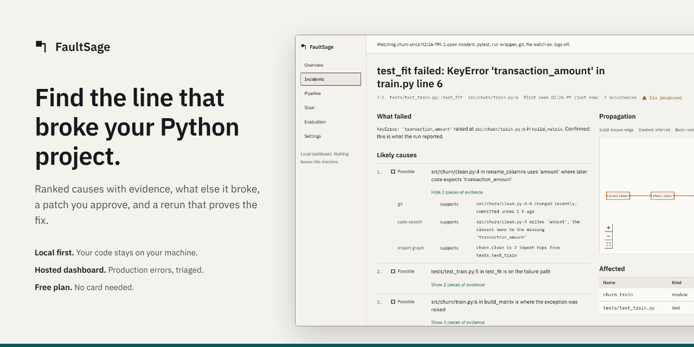

  
  
  
   
  
  
  
  
  
  
  
  
  
  
  
  

  <b>When a test or pipeline fails, FaultSage points to the line that caused it, shows the evidence, and proves the fix by rerunning the tests.</b> 
  <a href="https://faultsage.onrender.com"><b>Live demo</b></a> ·
  <a href="#see-it">See it</a> ·
  <a href="#how-it-works">How it works</a> ·
  <a href="#architecture">Architecture</a> ·
  <a href="#inside-the-backend">Backend</a> ·
  <a href="#measured-accuracy">Accuracy</a> ·
  <a href="#proof">Proof</a> ·
  <a href="#skills-and-tools">Skills</a>

<picture>
  <source media="(prefers-color-scheme: dark)" srcset="docs/images/at-a-glance-dark.png">
  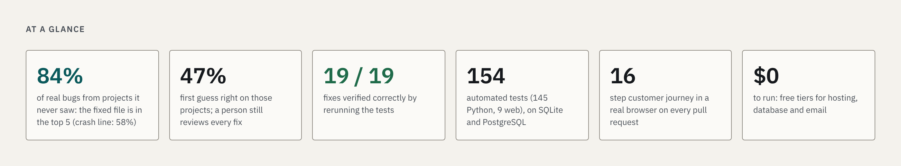
</picture>


## Try it

**[faultsage.onrender.com](https://faultsage.onrender.com)**: create a free account (email and password, or a code sent by email), add a project, copy its API key, and send an error from any Python app with three lines of the SDK. The free hosting sleeps when idle, so the first visit can take about 30 seconds.

## The problem

A stack trace tells you where a program crashed, not what broke it. In data and ML code the line that raises the error is often fine: a column was renamed upstream, a config changed, a step earlier in the pipeline wrote different data. **FaultSage ranks the likely causes with the evidence for and against each, shows what else the change affects, and checks the fix.**

## See it

<table>
<tr>
<th width="33%">Website</th>
<th width="33%">Sign in with an email code</th>
<th width="33%">A production error, triaged</th>
</tr>
<tr>
<td valign="top">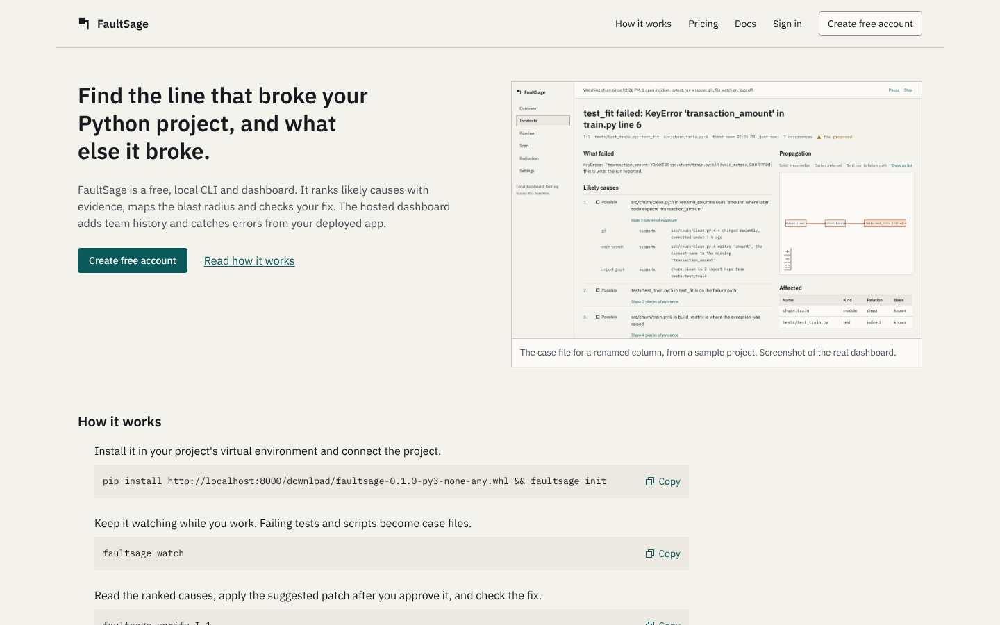</td>
<td valign="top">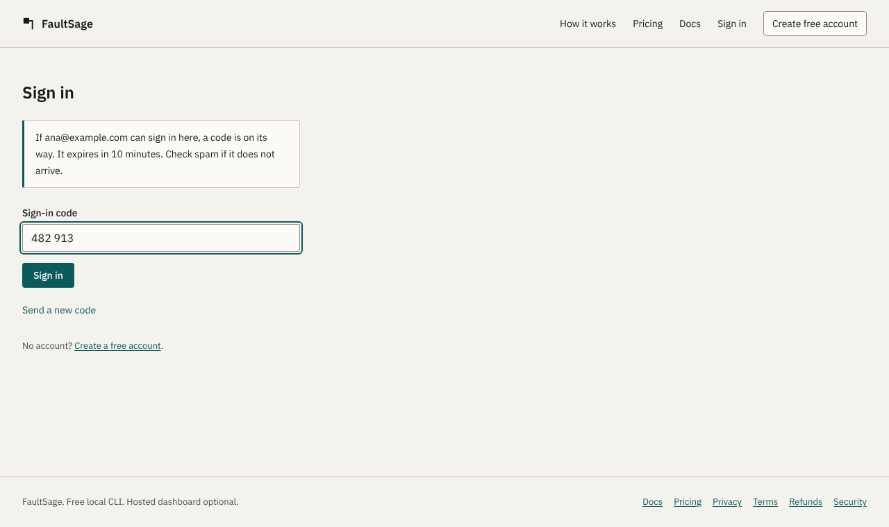</td>
<td valign="top">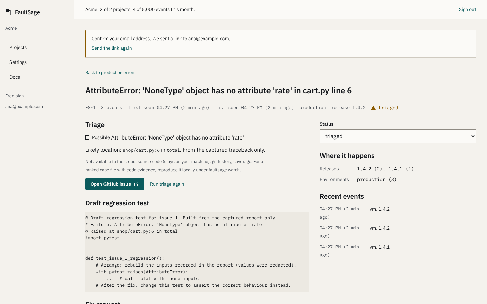</td>
</tr>
<tr>
<td valign="top">Free plan, pricing, docs, legal pages. Sign up with email and password, an emailed code, or GitHub.</td>
<td valign="top">No password needed: a 6-digit code by email, stored only as a keyed hash, valid for 10 minutes and 5 tries.</td>
<td valign="top">The SDK sends redacted errors from your app. Each issue gets a likely location, a draft test and a fix request.</td>
</tr>
</table>

<table>
<tr>
<th width="50%">Local dashboard: the case file</th>
<th width="50%">The whole customer journey</th>
</tr>
<tr>
<td valign="top">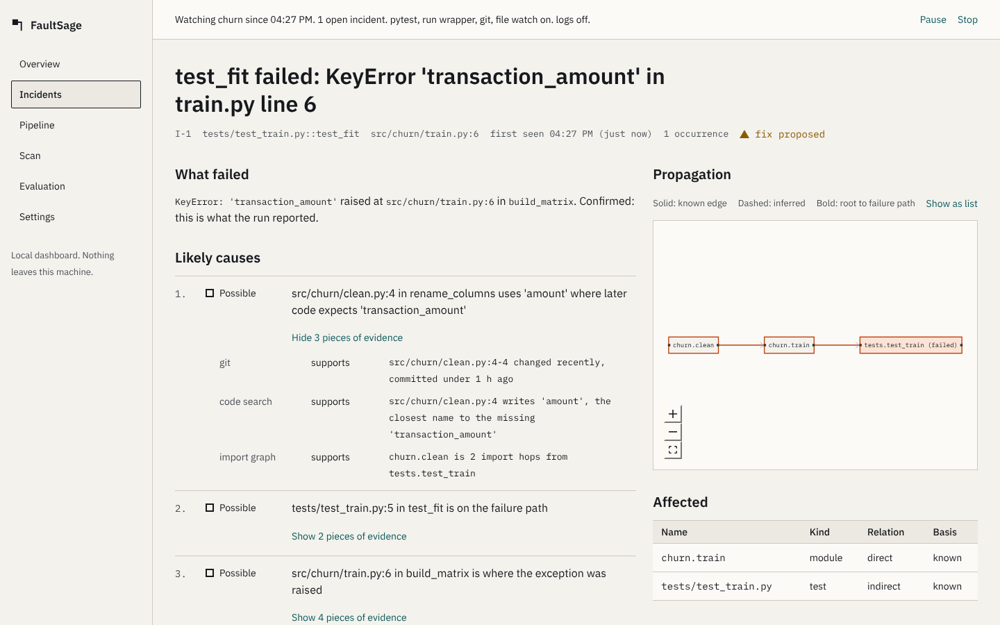</td>
<td valign="top">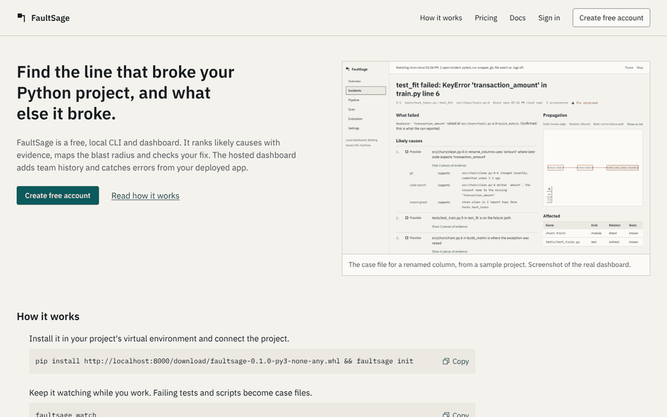</td>
</tr>
<tr>
<td valign="top">Runs on <code>127.0.0.1</code> with a one-time token. Ranked causes, evidence, propagation graph, and the patch behind an approval gate.</td>
<td valign="top">Recorded from the browser test that runs on every pull request: sign up, project, API key, a real error, a case file from the CLI.</td>
</tr>
</table>

## How it works

<picture>
  <source media="(prefers-color-scheme: dark)" srcset="docs/images/how-it-works-dark.png">
  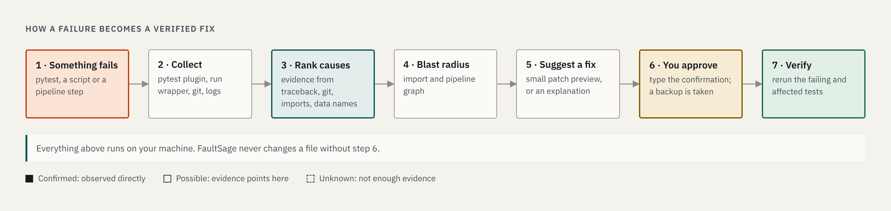
</picture>

| Label | Meaning |
|---|---|
| **Confirmed** | Observed directly: the exception, the line that raised it, a column missing in a checkpoint |
| **Possible** | Evidence points here; every piece of evidence for and against is listed |
| **Unknown** | Not enough evidence, and the dashboard says so |

A fourth label, *Strong*, exists but is switched off: on projects it had never seen it was right too rarely (see [results](docs/RESULTS.md)).

## Architecture

<picture>
  <source media="(prefers-color-scheme: dark)" srcset="docs/images/architecture-dark.png">
  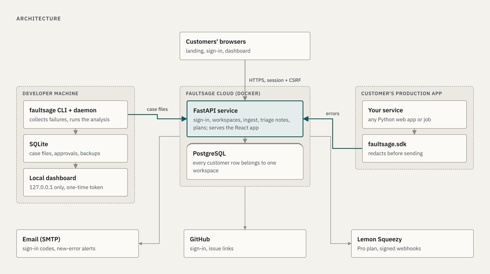
</picture>

## Inside the backend

<picture>
  <source media="(prefers-color-scheme: dark)" srcset="docs/images/request-lifecycle-dark.png">
  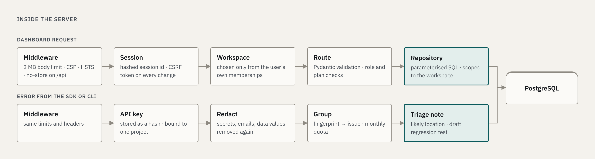
</picture>

<picture>
  <source media="(prefers-color-scheme: dark)" srcset="docs/images/data-model-dark.png">
  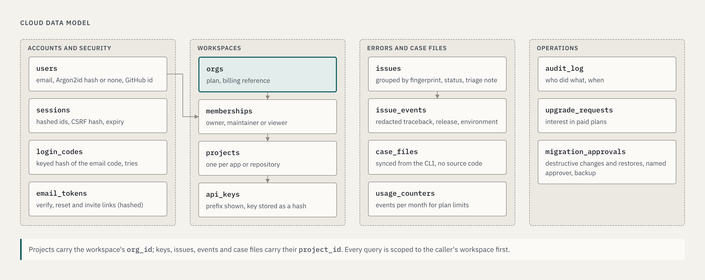
</picture>

<table>
<tr>
<td width="50%"><picture><source media="(prefers-color-scheme: dark)" srcset="docs/images/security-dark.png">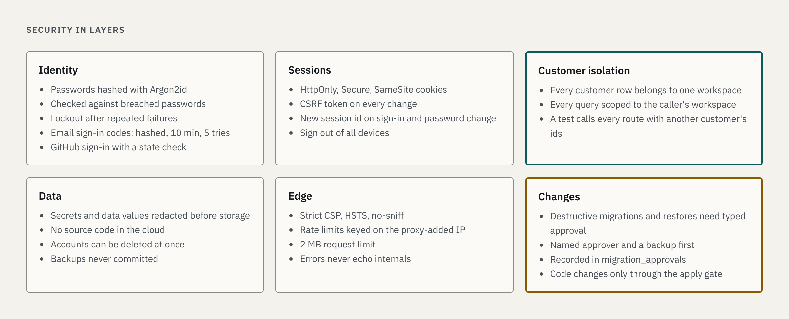</picture></td>
<td width="50%"><picture><source media="(prefers-color-scheme: dark)" srcset="docs/images/delivery-dark.png">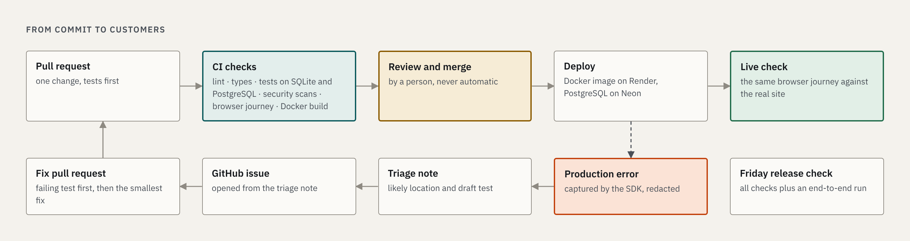</picture></td>
</tr>
</table>

<b>Engineering details</b> (stack, security, tests, CI)

| Area | What's in place |
|---|---|
| **Analysis** | Traceback parser (chained exceptions, pytest formats), AST index, import and pipeline graphs (NetworkX), spectrum-based localisation (Ochiai); a ranker that averages a logistic regression and a random forest, chosen and trained on the dev split only, with an executed training notebook |
| **Local tool** | Typer CLI, a daemon fed by a pytest plugin, a run wrapper, git and log readers through an append-only spool; SQLite in WAL mode; FastAPI dashboard on 127.0.0.1 with a one-time token |
| **Fixes** | Rule-based patch previews; an apply gate that refuses stale files and dirty git trees, needs the typed confirmation and keeps a backup; verification reruns the failing and affected tests |
| **Cloud** | FastAPI, SQLAlchemy Core, PostgreSQL; workspaces with owner, maintainer and viewer roles; Free and Pro plans with server-side limits |
| **Auth** | Email and password (Argon2id, breached-password check, lockout), one-time email codes, GitHub OAuth with a state check; hashed server-side sessions, CSRF tokens |
| **Security** | Strict CSP, HSTS, rate limits keyed on the proxy-added client IP, redaction before storage, no source code in the cloud, route-by-route tenant isolation test |
| **Frontend** | React 18, React Router 7, Vite, strict TypeScript, React Flow for the graph; own components on design tokens, light and dark |
| **Tests** | 145 Python tests (the 45 cloud tests also on PostgreSQL 16) and 9 web tests; axe-core on every screen at four widths; a 16-step customer journey in Chromium against the production Docker image |
| **CI on every PR** | Lint, types, tests, Bandit, Semgrep, pip-audit, gitleaks, a design check, the browser journey, a Docker build that must answer `/healthz` |
| **Safe changes** | Destructive migrations and database restores need a typed confirmation, a named approver and a backup, and are recorded |
| **Production errors** | Grouped by fingerprint, scrubbed of secrets, triaged with a draft test; GitHub issues labelled `prod-bug` get the same note |

Write-ups: [Architecture](docs/ARCHITECTURE.md) · [Security](docs/SECURITY.md) · [API reference](docs/api/openapi.json) · [Results](docs/RESULTS.md)

## Measured accuracy

Real bugs from [BugsInPy](https://github.com/soarsmu/BugsInPy). Projects are split once into **dev** (used to choose and train the model) and **test** (never seen until the model was frozen). A hit means the file the developer fixed is in the top k. Full tables and intervals: [docs/RESULTS.md](docs/RESULTS.md).

| On 19 bugs from projects it never saw | Top-1 | Top-3 | Top-5 |
|---|---|---|---|
| **FaultSage** | 0.47 | **0.79** | **0.84** |
| Top stack frame (the crash line) | **0.53** | 0.58 | 0.58 |
| Recently changed | 0.11 | 0.16 | 0.16 |
| Random | 0.07 | 0.21 | 0.32 |

The test set is 19 bugs, 16 of them from one project, so the 95% interval for Top-5 is 0.68 to 1.00 ([full tables](docs/RESULTS.md)).

<b>How the model was chosen</b>

Five candidate models were compared on the dev projects by leaving one project out at a time: train on the others, score the held-out one. The average of a logistic regression and a random forest was best both per bug (0.70 Top-1) and per project (0.63), so it was trained on all five dev projects (68 bugs), frozen in a commit, and only then run once on the test projects. Fix verification was right on 19 of 19.

## Proof

Screenshots of real output, not mock-ups. Each one names the run it came from.

### The deployed site passes the customer journey

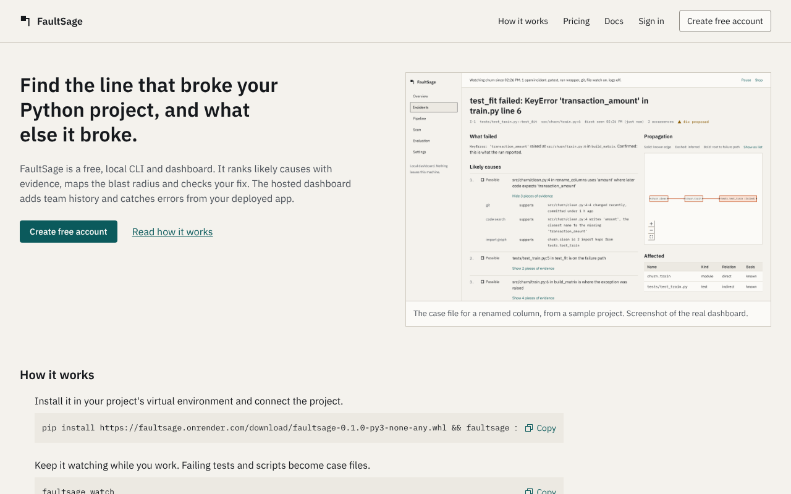

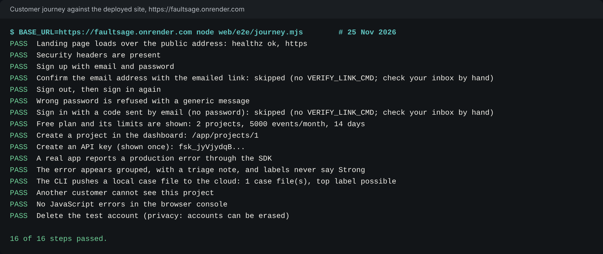

### Model choice and accuracy, from the executed notebook

The notebook ([results-only copy](selected-source/notebooks/ranker_results.ipynb)) was run once, top to bottom, and saved with its outputs. These are its cells as saved.

**Leave-one-project-out on the dev projects** (output of cell 3):

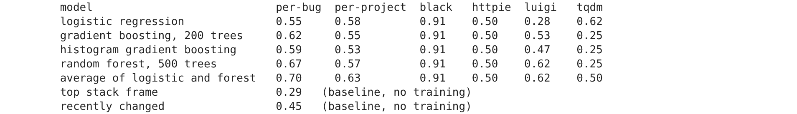

**Held-out test projects, read from the run record made after the model was frozen** (output of cell 6):

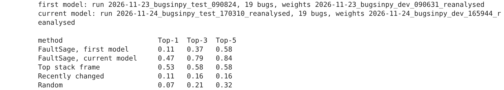

<table>
<tr>
<td width="50%">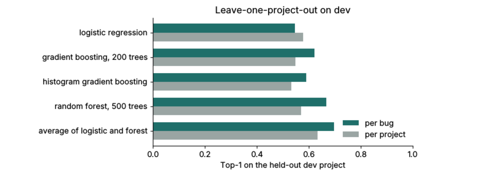</td>
<td width="50%">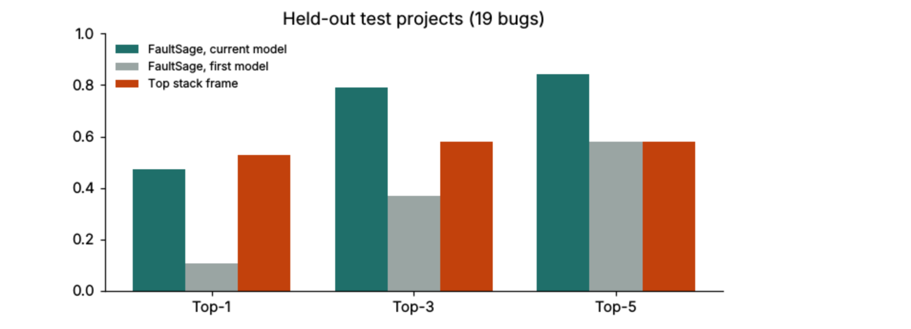</td>
</tr>
</table>

### Tests and checks

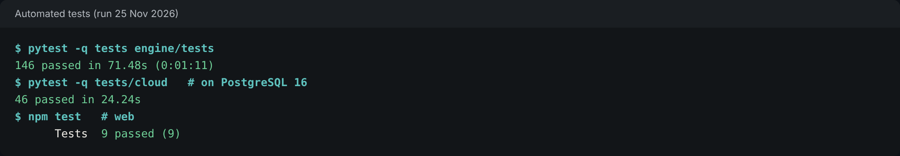

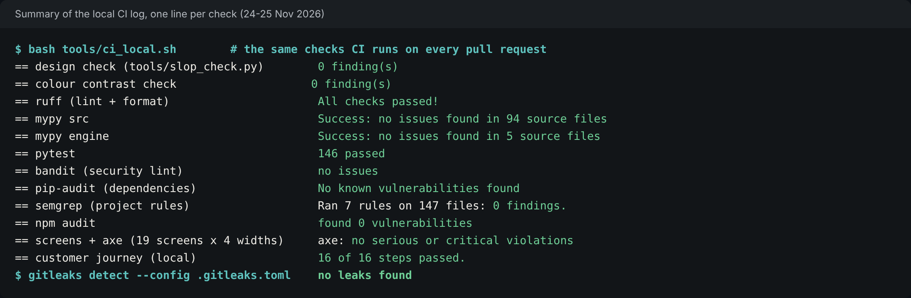

## Skills and tools

| Area | Used in this project |
|---|---|
| **Languages** | Python 3.12, TypeScript, SQL, CSS, JavaScript, Bash |
| **Machine learning** | scikit-learn (logistic regression, random forest, gradient boosting), feature engineering, leave-one-project-out validation, bootstrap confidence intervals, Jupyter |
| **Program analysis** | Python AST, traceback parsing, import and pipeline graphs with NetworkX, spectrum-based fault localisation (Ochiai), git history |
| **Backend** | FastAPI, Pydantic v2, SQLAlchemy Core, PostgreSQL, SQLite, Typer CLI, background workers |
| **Frontend** | React 18, React Router 7, Vite, React Flow, CSS Modules on design tokens, light and dark themes, accessibility (axe-core) |
| **Security** | Argon2id, one-time email codes, OAuth (GitHub), CSRF, CSP and HSTS, rate limiting, tenant isolation, secret redaction, HMAC-signed webhooks |
| **Testing** | pytest, Vitest, Playwright end-to-end tests, tests on SQLite and PostgreSQL, a benchmark harness on real bugs (BugsInPy) in Docker |
| **DevOps** | Docker, Render, Neon, GitHub Actions, Ruff, mypy, Bandit, Semgrep, pip-audit, gitleaks |
| **Product** | Free and Pro plans with server-side limits, billing webhooks, legal pages, email notifications, backups and restores behind human approval |

## About the source code

This repository is the public overview of FaultSage. A few real files are in [selected-source](selected-source/) to show the languages and the code style. The rest of the source (analysis engine, trained ranker and its training notebook, CLI, cloud service, web app, tests and benchmark harness) is kept in a private repository. If you are reviewing my work for a role, open an issue or message me through my GitHub profile and I will give you read access or walk you through the code.

## Licence

All rights reserved. The text, diagrams and screenshots here may be viewed on GitHub; any other use needs written permission. See [LICENSE](LICENSE).
