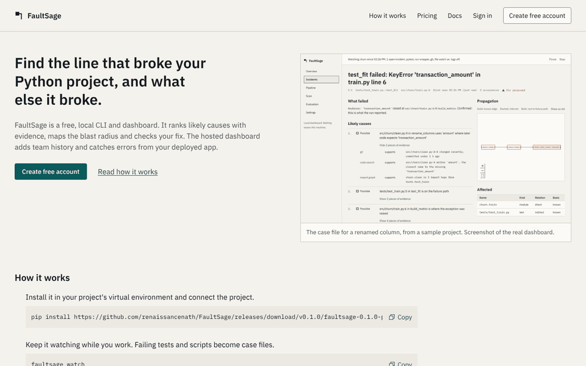
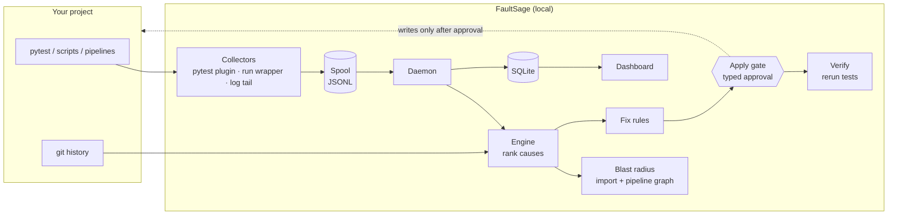
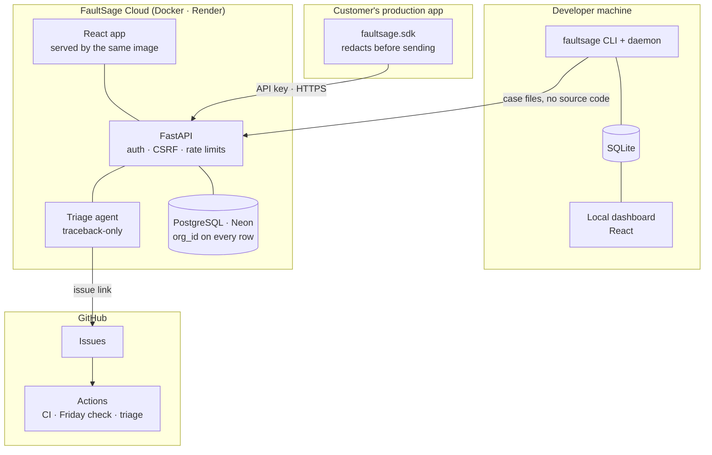
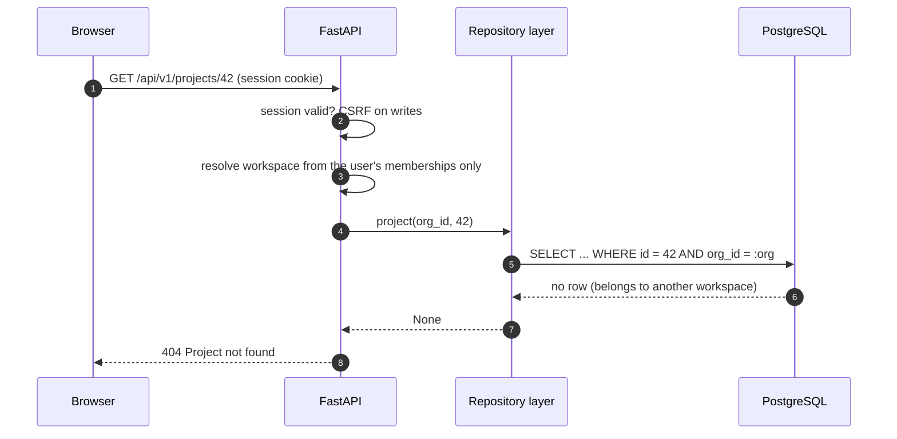
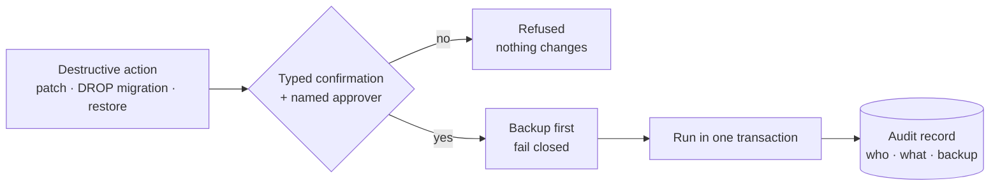
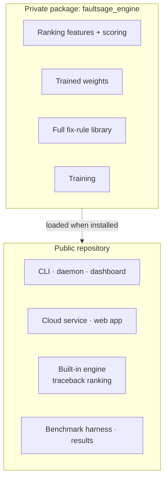
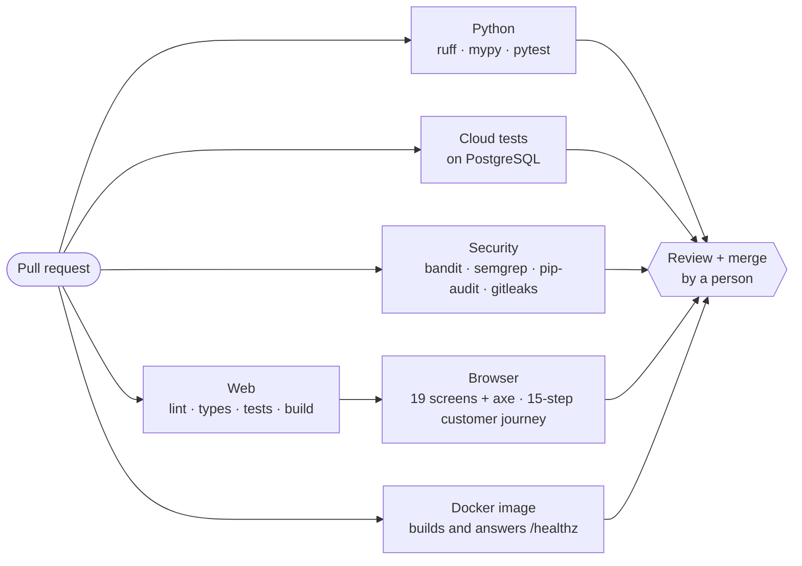

# FaultSage

**Finds the line that broke your Python project, shows what else it broke, and checks your fix.**

[](https://github.com/renaissancenath/FaultSage/actions/workflows/ci.yml)


<p align="center">
  
</p>

| | |
|---|---|
| **Local tool** | CLI + dashboard on `127.0.0.1`. Analysis, patches and verification run on your machine. |
| **FaultSage Cloud** | Accounts, workspaces, production error capture, triage notes. Free plan. |
| **Status** | Built and tested end to end locally. Deploy steps: [docs/LAUNCH.md](docs/LAUNCH.md). |

---

## How it works




## System architecture



## Customer data isolation



Every route with an id is called with another tenant's ids in [`tests/cloud/test_isolation.py`](tests/cloud/test_isolation.py); the test fails if a new route is added without being covered.

## Human approval for destructive actions



## Open core



## Evaluation (held-out projects)

Real bugs from [BugsInPy](https://github.com/soarsmu/BugsInPy); projects split into dev (tuning) and test (never seen). Test run [`2026-11-23_bugsinpy_test_090824`](results/runs/2026-11-23_bugsinpy_test_090824/run.json), 19 reproduced bugs:

| Method | Top-1 | Top-3 | Top-5 |
|---|---|---|---|
| FaultSage | 0.11 | 0.37 | 0.58 |
| Top stack frame | **0.53** | 0.58 | 0.58 |
| Random | 0.07 | 0.21 | 0.33 |

On unseen projects the ranker trails the top-stack-frame baseline at Top-1, so its "Strong" label is switched off until a new held-out run earns it back. Fix verification was correct on 19 of 19. Details: [docs/EVALUATION.md](docs/EVALUATION.md).

## CI on every pull request



## Stack

| Layer | Choice |
|---|---|
| Analysis | Python 3.12, AST, NetworkX, coverage.py, logistic regression |
| Local | Typer CLI, FastAPI on 127.0.0.1, SQLite (WAL) |
| Cloud | FastAPI, SQLAlchemy Core, PostgreSQL, Argon2id, GitHub OAuth |
| Web | React 18, TypeScript, Vite, React Flow, CSS Modules on design tokens |
| Ops | Docker, Render + Neon, GitHub Actions |

## Run it

```powershell
python -m pip install -e ".[dev]"
faultsage init ; faultsage watch        # dashboard at http://127.0.0.1:8765
faultsage-cloud serve                     # hosted part on http://localhost:8000
```

| Guide | |
|---|---|
| [LAUNCH.md](docs/LAUNCH.md) | GitHub, CI, Neon, Render, email, live check, step by step |
| [ARCHITECTURE.md](docs/ARCHITECTURE.md) | Components, boundaries, data flow |
| [DECISIONS.md](docs/DECISIONS.md) | Every design decision and open question |
| [SECURITY.md](docs/SECURITY.md) | Threat model and rules |
| [REQUIREMENTS_MAP.md](docs/REQUIREMENTS_MAP.md) | Where each requirement lives in the code |

## Not done yet

- Not deployed; GitHub CI runs on the first push ([LAUNCH.md](docs/LAUNCH.md)).
- Ranking accuracy on unseen projects is below the baseline; more varied dev projects are the next step.
- Payments are built but switched off until the legal pages are reviewed and a store is set up.

## Licence

All rights reserved, see [LICENSE](LICENSE). The ranking engine is a separate private package. Benchmark datasets keep their own licences. IBM Plex fonts: SIL OFL 1.1.
