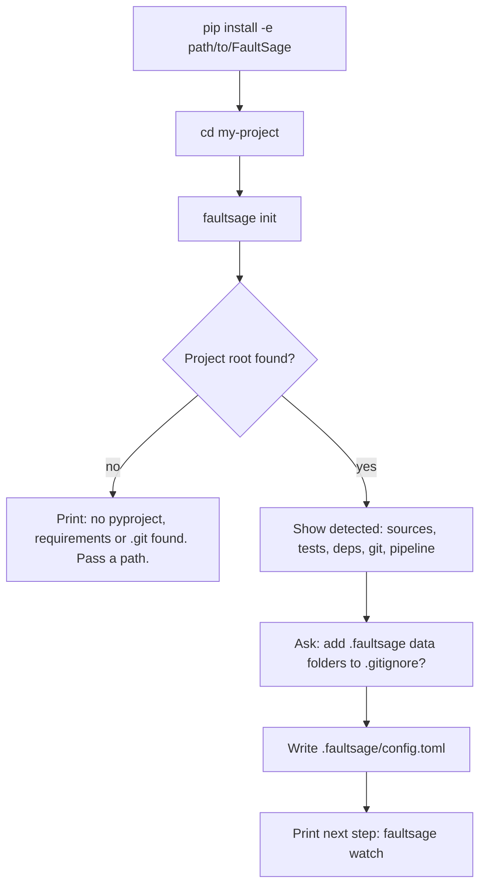
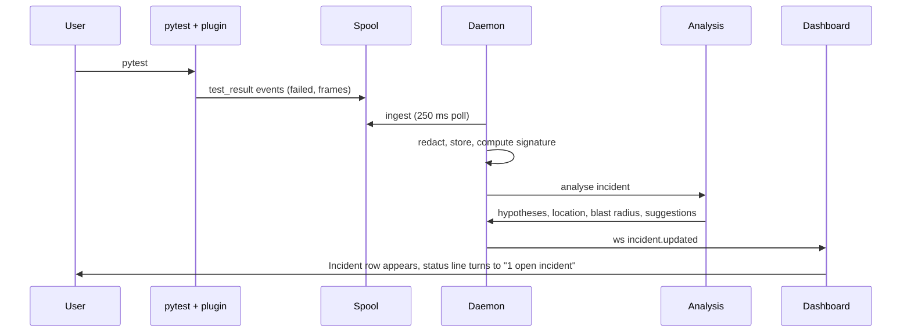
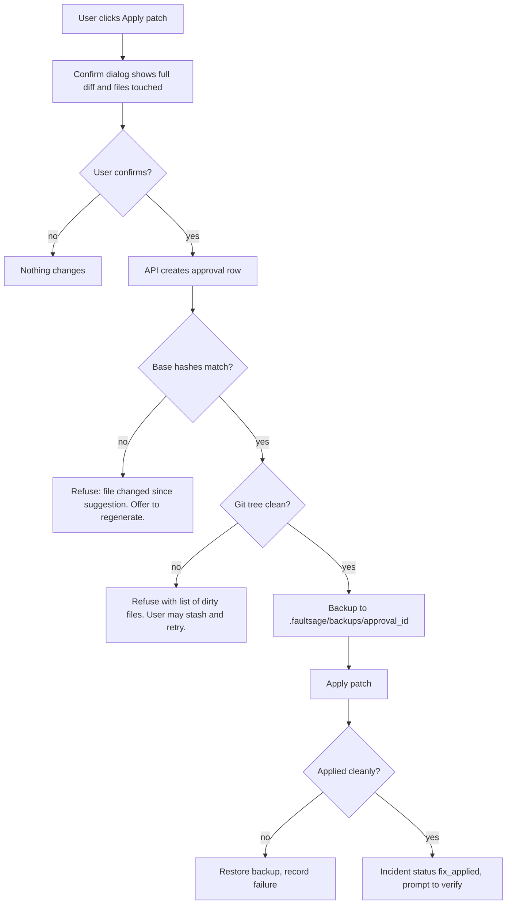

# FaultSage: App Flow

Each flow lists the trigger, steps, what the user sees, and the failure paths. Screen names match UI_UX_DESIGN_BRIEF.md.

---

## Flow 1. Install and connect

**Trigger:** user wants to monitor a project.



Terminal output is short and specific, for example:

```text
Project: churn-pipeline (C:\code\churn-pipeline)
Sources: src\churn (42 files)
Tests:   tests (118 tests)
Deps:    pyproject.toml
Git:     main @ 3f2c1ab
Pipeline: not declared (add .faultsage\pipeline.toml to map steps)
Config written: .faultsage\config.toml
Next: faultsage watch
```

---

## Flow 2. Watch session

1. `faultsage watch` starts the daemon, prints `Dashboard: http://127.0.0.1:8765/#t=<token>` and opens the browser if allowed. The token sits in the URL fragment so it is never sent to or logged by the server.
2. The dashboard exchanges the token for a cookie and removes it from the URL.
3. The status line shows "Watching churn-pipeline since 14:02. Pytest, run wrapper, git, file saves on. Logs off."
4. The user keeps working. Nothing else happens until a signal arrives.
5. `faultsage pause` stops ingest (collectors still spool). `resume` continues. `stop` ends the daemon.

Failure paths: port busy (next free port, printed), DB locked by another daemon (message names the PID and suggests `faultsage stop`).

---

## Flow 3. A test fails (main flow)



User then opens the **Case file** screen:

1. **What failed (Confirmed):** `KeyError: 'transaction_amount'` in `tests/test_train.py::test_fit`, raised at `src/churn/train.py:47` in `build_matrix`.
2. **Likely cause (ranked):**
   1. Strong: `src/churn/clean.py:31 rename_columns` renamed `transaction_amount` to `amount` (changed 2 hours ago, checkpoint `clean` output has `amount`, not `transaction_amount`).
   2. Possible: `src/churn/train.py:47` reads a column name that no longer exists.
3. **Evidence trail:** each item with its source (traceback, git diff, checkpoint, coverage) and stance (supports, contradicts).
4. **Affected:** `features.build`, `train.fit`, `evaluate.report`, 7 tests. Known edges solid, inferred dashed.
5. **Suggested fix:** patch preview, verify command.
6. **One primary action:** "Apply patch". Secondary text links: "Copy patch", "Dismiss incident".

---

## Flow 4. Command or script fails

1. `faultsage run -- python -m churn.pipeline`
2. Output streams to the terminal unchanged.
3. On non-zero exit, a `run_result` event is written with exit code, redacted stderr tail and, for Python entry points, the structured exception.
4. Same analysis as Flow 3.

---

## Flow 5. Pipeline step fails

1. User declared steps in `.faultsage/pipeline.toml` and added `faultsage.checkpoint(df, step="clean")` at step boundaries.
2. Checkpoints record column names, dtypes and shape.
3. When step `train` fails with a missing column, the schema evidence shows which upstream checkpoint last had that column and where it disappeared.
4. The **Pipeline** screen shows steps as a left-to-right graph: passed (filled circle + "passed"), failed (filled square + "failed"), not run (outline circle + "not run"), and the root-to-failure path highlighted.

---

## Flow 6. Deep scan

1. `faultsage scan` or the "Run scan" action on the Scan screen.
2. Runs: import resolution, Ruff checks for undefined names and unused imports, circular import detection, declared pipeline consistency, current test status (`pytest --co` and optional run).
3. Results grouped by file with severity in words (error, warning, note).
4. Scan findings are not incidents unless the user promotes one.

---

## Flow 7. Apply a fix (approval gate)



In the terminal the same gate is `faultsage apply S-17`, which prints the diff and requires typing `apply S-17`.

---

## Flow 8. Verify

1. User clicks "Run verification" (primary action once a fix is applied) or runs `faultsage verify I-42`.
2. Runner executes pytest for the failing node ids and affected tests, with timeout.
3. Result panel: "Fixed: test_fit passes. 7 of 7 affected tests pass. No new failures." or "Still failing: same KeyError at train.py:47."
4. Incident moves to `verified` then `resolved` (user confirms), or `reopened`.

---

## Flow 9. Incident history and export

1. **Incidents** screen: table with id, title, status, first seen, last seen, occurrences, top cause certainty.
2. Filters: status, file, date. Sorting by any column.
3. Export a case file as Markdown or JSON.

---

## Flow 10. Benchmark run (developer flow)

1. `faultsage bench fetch bugsinpy` records the dataset commit.
2. `faultsage bench run bugsinpy --split dev` then `--split test`.
3. `faultsage bench report RUN_ID` prints the metrics table with baselines.
4. **Evaluation** screen shows the latest run records with run id, dataset version, number of cases attempted, reproduced, excluded, and metrics with baselines side by side.

---

## Flow 11. FaultSage's own errors (self-monitoring)

1. Any uncaught error in the daemon, API or analysis is captured by `selfmon.hook` into `~/.faultsage/self/` with redaction.
2. `faultsage self-report` prints the latest internal incidents.
3. Developers triage these with the production-bug flow in RELEASE_AND_OPERATIONS.md.

---

## Flow 12. Purge and uninstall

1. `faultsage purge` lists what will be deleted (events, incidents, backups, logs) with sizes, asks for typed confirmation.
2. `faultsage purge --all` also removes `.faultsage/config.toml`.
3. `pip uninstall faultsage` removes the package. Project files are never touched.
