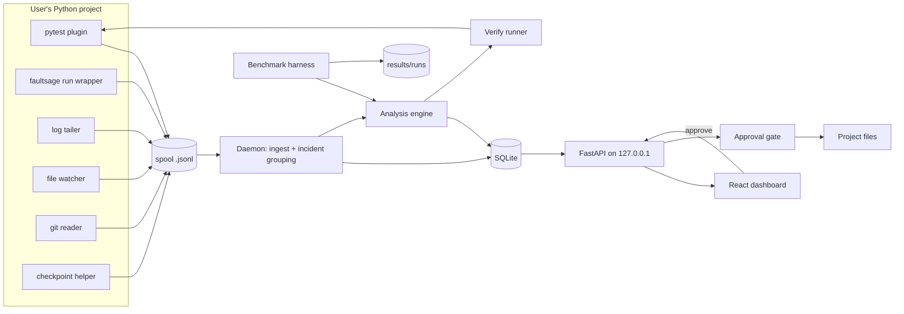
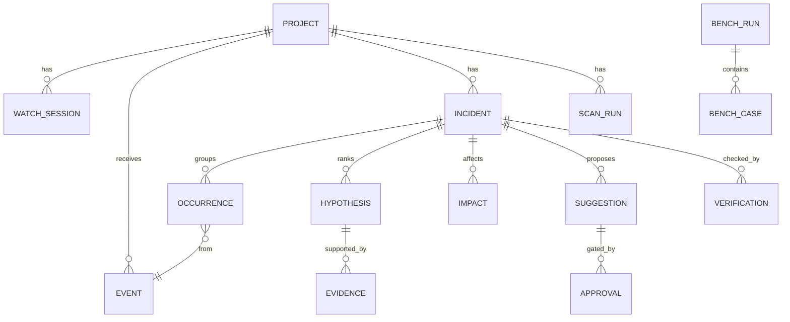
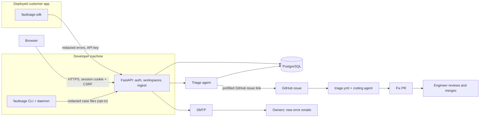

# FaultSage: Architecture

| Field | Value |
|---|---|
| Version | 2.0 |
| Covers | Framework, database, auth, integrations, structure, data flow, failure handling |

---

## 1. System overview

FaultSage is one Python package with four runtime pieces, all on the user's machine:

1. **Collectors** run inside or beside the user's project (pytest plugin, `run` wrapper, log tailer, file watcher, git reader, checkpoint helper). They only write events to a local spool folder.
2. **Daemon** (`faultsage watch`) reads the spool, stores events, groups them into incidents and triggers analysis.
3. **Analysis engine** turns an incident into hypotheses, a location, a blast radius, fix suggestions and verification results. It is pure Python with no web or UI code.
4. **Dashboard** is a FastAPI app (in the daemon process) serving a prebuilt React app and a small JSON + WebSocket API on `127.0.0.1`.

A fifth piece, the **benchmark harness**, reuses the analysis engine on real bug datasets inside containers. It is how accuracy is measured.



Why a spool folder instead of the pytest plugin calling the API: tests must never fail or slow down because the daemon is not running. Collectors write files; the daemon picks them up when it runs.

---

## 2. Tech stack

All free and open source. Licences are listed in TRD.md section 2.

| Layer | Technology | Why |
|---|---|---|
| Language | Python 3.11+ | Same language as the projects it monitors; AST and traceback access |
| CLI framework | Typer | Typed commands, generated help |
| Daemon web framework | FastAPI + Uvicorn | Async, typed, WebSocket support |
| Validation | Pydantic v2 | One schema for spool events, API and storage |
| Database | SQLite (WAL mode) | Zero setup, single file per project, enough for one user |
| Graph analysis | NetworkX | Import graph, pipeline graph, reachability |
| Coverage | coverage.py contexts via pytest-cov | Per-test line coverage for Ochiai |
| Static checks in scan | Ruff (subprocess) | Fast, free, finds undefined names and import errors |
| Frontend | React + TypeScript + Vite | Component model, typed API client |
| Graph view | React Flow core | Interactive node graph, MIT |
| Styling | Plain CSS with design tokens (`design/tokens.css`) and CSS Modules | Full control, no template look; no component kit |
| Icons | Phosphor (regular) | MIT, not the default Lucide look |
| Fonts | IBM Plex Sans + IBM Plex Mono, self-hosted | Real typefaces, OFL |
| Optional model | Ollama on localhost | Local, free, off by default |
| Benchmarks | Docker Engine or Podman in WSL2 | Isolation for untrusted benchmark code |

### Framework, database, auth, integrations at a glance

| Concern | Decision |
|---|---|
| Framework | Typer CLI + FastAPI daemon + React static UI |
| Database | SQLite file at `.faultsage/faultsage.db`, migrations in code |
| Auth | Local only: bind to 127.0.0.1, per-session random token exchanged for an HttpOnly cookie, Host and Origin checks. No accounts in v1. |
| Integrations | pytest (plugin), git (CLI), Ruff (CLI), coverage.py, optional Ollama, optional GlitchTip for FaultSage's own errors. No cloud services. |

---

## 3. Project structure

```text
FaultSage/
  AGENTS.md
  README.md
  pyproject.toml
  src/faultsage/
    __init__.py
    cli/
      main.py              # Typer app: init, watch, scan, run, verify, apply, bench...
    config/
      model.py             # Pydantic config models
      loader.py            # read/write .faultsage/config.toml
    collectors/
      pytest_plugin.py     # pytest11 entry point
      run_wrapper.py       # faultsage run -- cmd
      launcher.py          # runpy launcher with exception hook
      log_tailer.py
      fs_watcher.py
      git_reader.py
      checkpoint.py        # faultsage.checkpoint(df, step=...)
      spool.py             # append-only JSONL writer, rotation
    daemon/
      service.py           # lifecycle: start, pause, stop
      ingest.py            # spool -> events table
      grouping.py          # signatures -> incidents
    analysis/
      traceback_parser.py
      ast_index.py
      import_graph.py
      pipeline_graph.py
      sbfl.py              # Ochiai from coverage contexts
      candidates.py
      features.py
      ranker.py
      weights.json         # trained weights + run id
      certainty.py
      blast_radius.py
      scan.py
    fixes/
      rules/               # one module per rule
      suggest.py
      patch.py             # diff building, hash checks
      apply_gate.py        # approval, backup, write
    verify/
      runner.py
    storage/
      db.py
      migrations/          # 0001_init.sql, 0002_...sql
      repo_*.py            # one repository module per aggregate
    api/
      app.py
      auth.py
      routes/              # projects, incidents, graph, suggestions, approvals, scans, bench
      ws.py
    bench/
      datasets/            # bugsinpy.py, junobench.py, logsage.py, logchunks.py
      container.py
      baselines.py
      metrics.py
      runner.py
    models/                # Pydantic models shared by spool, engine, API (BACKEND_SCHEMA.md)
    selfmon/
      hook.py              # FaultSage's own error capture
    redact.py              # secret redaction used by every collector
    paths.py               # inside_root() and path normalisation
    errors.py              # error classes with code, message, next_step
  web/
    index.html
    src/
      api/                 # typed client generated from OpenAPI
      components/
      pages/
      styles/              # imports design/tokens.css
    public/fonts/          # Plex WOFF2 + OFL.txt
  design/
    tokens.css
  tests/
    unit/
    integration/
    e2e/
    fixtures/              # recorded from real benchmark runs, each with PROVENANCE.md
  docs/
  results/runs/            # committed run records
  data/                    # gitignored benchmark checkouts
  tools/
    slop_check.py
    ci_local.ps1
    ci_local.sh
    semgrep/faultsage.yml
  .agents/skills/faultsage-design/SKILL.md
  .github/
```

---

## 4. Data flow

### 4.1 Failing test to incident
1. User runs `pytest`. The FaultSage plugin is active because it is installed in the same environment.
2. For each failed report the plugin writes a `test_result` event with structured frames to `.faultsage/spool/`.
3. The daemon's ingest loop (polls every 250 ms, also triggered by the file watcher) validates each line with Pydantic, redacts secrets, inserts into `events`.
4. Grouping computes the signature and creates or updates an `incident`.
5. The analysis engine runs: parse traceback, index AST, build or reuse the import graph, collect candidates, compute features, score, label certainty, compute blast radius, match fix rules.
6. Results are stored (`hypotheses`, `evidence`, `impacts`, `suggestions`).
7. The WebSocket broadcasts `incident.updated`. The dashboard refetches the incident.

### 4.2 Approve and verify
1. User clicks "Apply patch" on a suggestion. The API creates an `approval` row with the patch hash.
2. The apply gate checks base file hashes, path containment and git state, writes a backup, applies the patch, records the result.
3. User (or the dashboard button "Run verification") triggers verify. The runner executes pytest for the failing node ids plus affected tests.
4. Results go to the spool like any other test run, so the same pipeline updates the incident to `verified` or `reopened`.

### 4.3 Benchmark run
1. `bench run bugsinpy --split test` reads the case list for the split.
2. For each case: create container, check out buggy commit, install dependencies, disable network, run the failing tests with the FaultSage plugin and coverage contexts.
3. Copy the spool out, run the analysis engine on the host, compare predictions with the developer's fix (ground truth), run baselines on the same inputs.
4. Run the developer's fix commit and check that `verify` reports resolved.
5. Write `run.json` and `cases.jsonl`.

---

## 5. Scalability and future considerations

| Topic | Now | Later, only when needed |
|---|---|---|
| Users | One user, one project | Multi-project registry in a user-level DB (`~/.faultsage/registry.db`) |
| Storage | SQLite WAL | PostgreSQL only if a multi-user server version is built |
| Graph size | Rebuilt incrementally on file save, cached by file hash | Persisted graph snapshots |
| Analysis cost | Synchronous per incident | Worker process with a queue if analysis exceeds 3 s |
| Languages | Python | Language adapters behind a `TracebackParser` and `ImportGraph` interface |
| Model | Optional local Ollama | Any local OpenAI-compatible endpoint, still local only |
| Distribution | `pip install` from repo | PyPI wheel with bundled dashboard build |

Interfaces that keep these changes cheap: collectors only know the spool format; the engine only knows Pydantic models; the API only calls service functions.

---

## 6. Request lifecycle

For a dashboard request such as `GET /api/incidents/42`:

1. Uvicorn on 127.0.0.1 accepts the connection.
2. Middleware checks the `Host` header is `127.0.0.1:<port>` or `localhost:<port>` (DNS rebinding defence).
3. Auth dependency checks the session cookie against the in-memory token hash.
4. For state-changing methods, it also checks `Origin` and the `X-FaultSage-Request: 1` header.
5. The route validates path and query with Pydantic.
6. The route calls a service function (for example `incidents.get_case_file(42)`), never SQL directly.
7. The service uses repository functions with parameterised SQL.
8. The response model strips internal fields and is returned as JSON.
9. Access log line written without query strings or bodies.

For a write such as approving a patch, steps 6 to 8 also: insert an approval row, run the apply gate, record the outcome, broadcast over WebSocket.

---

## 7. Data model

Main entities (full DDL in DATABASE.md):



---

## 8. Dependency rules

1. `collectors` import only `spool`, `redact` and the event models. They never import `daemon`, `api` or `analysis`.
2. `analysis` imports no web framework, no database module. It takes models in, returns models out.
3. `storage` owns all SQL. No SQL strings anywhere else.
4. `api` routes call service functions in `daemon` or thin service modules. No business logic in routes.
5. `fixes.apply_gate` is the only module allowed to write to project files. A test enforces this by scanning imports of `open(..., "w")`, `Path.write_text` and `os.replace` outside it.
6. `bench` may use everything above, but nothing imports `bench`.
7. `web` talks only to the documented API. No direct file or DB access.
8. Circular imports between packages are a CI failure (checked with a NetworkX script over our own import graph).

---

## 9. Security

Summary here, rules in `docs/security/`.

- Local only: bind 127.0.0.1, Host and Origin checks, session token cookie.
- Least access: collectors read only what config allows.
- Writes only through the approval gate with backup and audit row.
- No shell execution; only pytest node ids and user-declared commands run.
- Secrets redacted before storage; checkpoints store names and shapes only.
- Untrusted text (tracebacks, logs, code) rendered as text, never as HTML.
- Benchmark code only runs in network-isolated containers.
- Dependency audit (pip-audit, npm audit), secret scan (gitleaks), static analysis (Bandit, Semgrep CE) in CI.

---

## 10. Failure handling

| Failure | Behaviour |
|---|---|
| Daemon not running | Collectors keep writing to the spool; ingest catches up on next start |
| Spool line invalid | Line moved to `spool/rejected/` with reason; ingest continues |
| Plugin internal error | Swallowed, logged to `.faultsage/logs/plugin.log`, test run unaffected |
| Analysis exception | Incident stored with status `open` and an analysis error note; error captured by self-monitoring |
| Source file missing or changed since failure | Location marked "line not available" or "file changed since failure" |
| Graph build fails on a syntax error | Graph built for other files; the broken file is flagged in scan |
| Patch base hash mismatch | Suggestion marked stale; apply refused |
| Apply fails midway | Restore from backup, record failure, incident unchanged |
| Verify timeout | Process tree killed, verification recorded as `timeout` |
| DB locked | Retry with backoff up to 2 s, then fail the request with a clear message |
| DB corrupt | Daemon refuses to start, prints recovery steps, never deletes the file itself |
| Port in use | Try next 10 ports, print the chosen URL |
| Optional model unreachable | Rule-based suggestions only; UI says the model is off or unreachable |
| Benchmark case fails to build | Case recorded as `unreproducible` with log; excluded from metrics and counted in the report |

---

## 11. FaultSage Cloud (D-014 to D-021)

An optional hosted service. The local tool keeps working without it and never needs it.



### At a glance

| Concern | Decision |
|---|---|
| Framework | FastAPI app `faultsage.cloud.app:create_app`, serves the same React build as the local dashboard; the app detects its mode from `/api/v1/meta` |
| Database | PostgreSQL in production (Neon or any Postgres), SQLite for development and tests; SQLAlchemy Core with parameterised text SQL only in `cloud/storage/`; numbered migrations with the same destructive gate as local (D-016) |
| Auth | Email + password with Argon2id (64 MiB), breached-password list, lockout with backoff, email verification and reset over SMTP, optional GitHub OAuth; sessions are 256-bit random ids stored hashed, `__Host-` Secure HttpOnly cookies over HTTPS, rotated on sign-in and password change; double-submit CSRF token on every change (D-015) |
| Tenancy | Workspace (org) with roles owner, maintainer, viewer; every query is scoped by org id; tests check isolation |
| Ingest auth | Per-project API keys `fsk_...`, shown once, stored as SHA-256, revocable; rate limited per key |
| Plans | Free and Pro in `cloud/plans.py`; limits on projects, events per month, retention, seats; no payment provider wired (D-017, Q-004) |
| Integrations | SMTP (any server), GitHub OAuth (optional), GitHub issue links from triage, Lemon Squeezy webhook adapter (off), Render, Docker |
| Hosting | One Docker image; `render.yaml` (free tier) or `docker-compose.yml` with Caddy for HTTPS (D-018) |

### Code layout

```text
src/faultsage/cloud/
  app.py            # FastAPI app, security headers, lifespan: safe migrations, housekeeping thread
  settings.py       # environment variables (.env.example)
  security.py       # Argon2id, lockout, tokens, API keys, rate limiter
  deps.py           # session user + CSRF, roles, API key auth, client IP
  routes/auth.py    # sign up, sign in, verify, reset, GitHub OAuth
  routes/workspace.py  # me, org, members, projects, keys, issues, case files, billing
  routes/ingest.py  # /api/v1/ingest/events (SDK), /case-files (CLI), /whoami
  ingest.py         # validation, redaction, grouping, quota
  triage_agent.py   # traceback-only ranking, draft test, agent prompt, GitHub issue link
  plans.py, mailer.py, cli.py (faultsage-cloud serve | db status | db migrate)
  storage/db.py, storage/repo.py, storage/migrations/
src/faultsage/sdk.py   # runtime error capture for deployed Python apps
```

### What the cloud never receives

Source files, secret values, environment values, data values. The CLI and SDK redact before sending; the server redacts again. Case files contain paths, line numbers, short redacted excerpts and the ranked claims.

### Failure handling

| Failure | Behaviour |
|---|---|
| Cloud unreachable from the CLI | Push fails quietly into self-monitoring; local flow unaffected |
| SDK cannot send | Bounded queue drops events; the app is never blocked or crashed |
| Monthly limit reached | Event refused with 402 `plan_limit`, counted as dropped |
| Destructive migration pending | Never applied on start; production refuses to start until approved |
| SMTP missing | Links written to the server log; signup still works |
| Unexpected exception | 500 with a generic message; details go to self-monitoring, never to the client |

## 12. Open core (D-032)

`faultsage.analysis.engine` picks the engine at import time:

| Installed | Engine | Ranking | Fix rules |
|---|---|---|---|
| `faultsage` only | `faultsage.analysis.basic` | traceback frames, innermost non-test frame first | `fixes/rules/basic.py` (import errors, version conflicts, missing files) |
| `faultsage` + `faultsage_engine` (private) | `faultsage_engine.engine` | trained ranker over traceback, git, coverage, import-graph and schema evidence | full library, including patch-producing rules |

Both take a `Snapshot` and return an `AnalysisResult` (`analysis/types.py`), so the daemon, CLI, dashboard and cloud are unaware of which ran. Benchmark run records store the engine name and the SHA-256 of the weights file used. A broken engine install raises instead of silently falling back.
