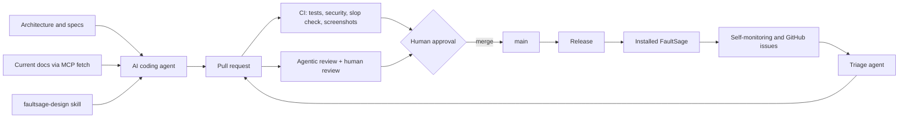

# FaultSage: Release and Operations

How changes get checked, released, and how bugs that only appear on real machines get caught and fixed. All tooling is free and open source.

## 1. The system

Pieces:
1. Architecture and specs: `docs/`.
2. Current documentation: free MCP servers (fetch, git, filesystem) so agents code against installed APIs.
3. Design skill: `.agents/skills/faultsage-design/SKILL.md` + tokens.
4. Human approval write gate: on merges, destructive migrations, and inside the product (apply gate).
5. Automated tests: TESTING.md.
6. Error monitor: FaultSage's own self-monitoring (and optional self-hosted GlitchTip).
7. AI agent: whichever coding agent the engineer uses. The codebase never depends on a paid AI service.

## 2. Checks on every pull request

CI (`.github/workflows/ci.yml`, GitHub Actions on the public repo, or `tools/ci_local.ps1` offline):

| Job | Commands |
|---|---|
| Python quality | `ruff check .`, `ruff format --check .`, `mypy src` |
| Python tests | `pytest -q` (unit, contract, security), integration not-slow |
| Security | `bandit -q -r src`, `semgrep scan --config tools/semgrep --metrics=off` (Community Edition, local rules, no account), `pip-audit`, `gitleaks detect` |
| Web | `npm ci`, `npm run lint`, `npm run typecheck`, `npm test`, `npm run build`, `npm audit --omit=dev` |
| UI | Playwright screens + axe, upload screenshots as artifact |
| Design | `python tools/slop_check.py`, `python tools/slop_check.py --contrast` |
| No network | Runtime test job with network disabled |

Plus:
- **Agentic review** using the review prompt in PROMPTS.md, posted as a PR comment by the engineer's agent.
- **Human review**: the engineer reads the diff, the agent review and the screenshots. Only the engineer merges.
- **Breaking-change check**: if a PR changes spool format, API schema, DB schema or CLI flags, the PR template requires a migration note and version bump plan.

## 3. Friday release check

Before tagging a release (any day, but it is called the Friday check because it is a weekly habit):

1. All PR checks green on `main`.
2. Breakouts: run `faultsage` end to end on two real projects (one BugsInPy case and one of the engineer's own projects, for example the Fintestix backend once it exists). Note anything odd.
3. Read open GitHub issues and bug emails. Any blocker? Fix or postpone the release.
4. Run the test-split benchmark only if analysis code changed. Update README numbers from the new run record.
5. Complete `docs/security/05_LAUNCH-CHECKLIST.md`.
6. Tag, write plain-language release notes with the rollback command (`pip install git+https://github.com/renaissancenath/FaultSage@vPREVIOUS`).

## 4. Bug reports from users

- GitHub issue templates (`.github/ISSUE_TEMPLATE/bug_report.md`) ask for version, OS, command, what happened, expected, and a redacted `faultsage export` of the incident if relevant.
- Email reports go to an address the engineer controls; they are copied into an issue (without personal data) on the same day.

## 5. Production-only bugs (on users' machines)

Runtime failures that tests did not catch:

1. **Capture**: `selfmon.hook` records FaultSage's own uncaught errors locally with redaction (`~/.faultsage/self/`). Users run `faultsage self-report --export` and attach it to an issue. Optional: users point it at their own self-hosted GlitchTip.
2. **Triage**: the engineer gives the export to the coding agent with the triage prompt (PROMPTS.md). The agent groups duplicates, writes a failing test from the captured data, and finds the cause.
3. **Fix PR**: the agent opens a PR with the test and the smallest fix. CI runs.
4. **Review**: the engineer reviews and merges. No auto-merge, no hotfix straight to main.
5. **Release**: patch version with notes linking the issue.

## 6. Destructive operations

- The engineer says "clean up unused tables": the agent writes a `_destructive.sql` migration, lists exactly what will be dropped and what data is lost, and stops.
- The engineer approves that specific migration. It runs with a backup.
- The next destructive operation needs a new approval. Approvals do not carry over.
- On a user's machine, destructive migrations require `faultsage db migrate --approve <version>` typed by the user.

## 7. Versioning

Semantic versioning. Spool schema, API schema and DB schema versions are tracked separately and listed in release notes.

## 8. Where each piece lives

| Piece | Files |
|---|---|
| PR checks | `.github/workflows/ci.yml` (python, postgres, no-network, secrets, web, screens, docker), `tools/ci_local.sh`, `tools/ci_local.ps1` |
| AI review | `.github/workflows/ai-review.yml` + `tools/ai_review.py` (only with your own AI provider key; otherwise the review prompt by hand) |
| Friday release check | `.github/workflows/release-check.yml`, `tools/breakout.sh`, `tools/release_report.py` |
| Bug emails to issues | `.github/workflows/bug-inbox.yml`, `tools/email_to_issue.py` (strips sender details) |
| Production error monitor | `faultsage.sdk` in the customer app, FaultSage Cloud issues, new-error emails to owners and maintainers |
| Triage agent | `src/faultsage/cloud/triage_agent.py` (each issue), `faultsage triage` + `.github/workflows/triage.yml` (issues labelled `prod-bug`), skill `faultsage-triage` |
| Fix PR and review | The engineer's coding agent opens the PR from the triage prompt; CI runs; the engineer merges |
| Destructive gate for agents | coding-agent hook config calling `tools/hooks/destructive_gate.py`, skill `faultsage-migrations` |
| Current docs for agents | `.mcp.json` (fetch, git, filesystem) |
| Deployment | `Dockerfile`, `render.yaml`, `docker-compose.yml`, `deploy/Caddyfile`, `docs/DEPLOY.md` |
