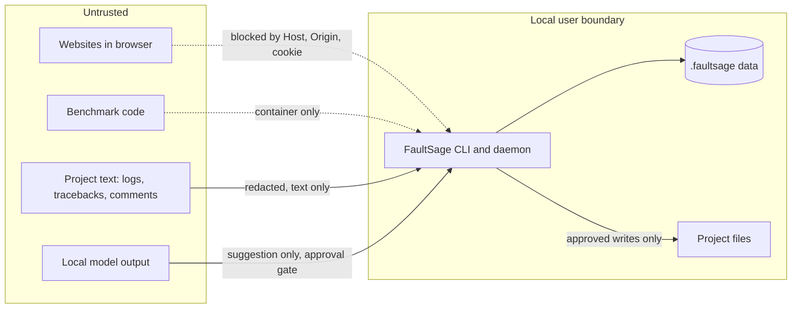

# 04 Attack Surface Map

| # | Entry point | Who can reach it | Threat | Mitigation (rule ids) | Residual risk |
|---|---|---|---|---|---|
| 1 | HTTP API on 127.0.0.1 | Local processes, browser tabs | Malicious website sends requests to localhost (CSRF) | SameSite=Strict cookie, Origin check, custom header (SR-3, SR-4, LR-5) | Low |
| 2 | HTTP API via DNS rebinding | Remote website resolving to 127.0.0.1 | Reads incident data | Host header allowlist (SR-2), session cookie | Low |
| 3 | WebSocket `/ws/events` | Browser tabs | Cross-site WebSocket hijacking | Origin check + cookie (SR-3) | Low |
| 4 | `/auth/session` | Local processes | Token guessing | 256-bit token, one-time, rate limit (LR-4) | Very low |
| 5 | Other local users on a shared machine | Same host | Read `.faultsage/` or use the port | User-only folder permissions (SR-15), cookie auth | Medium on shared machines: documented |
| 6 | Dashboard rendering of tracebacks, logs, code, file names | Anyone who can make the project print text (dependencies, data files, test names) | Stored XSS | Text-only rendering, CSP, slop check bans innerHTML (SR-5, SR-17) | Low |
| 7 | Spool files | Any process that can write the project folder | Forged events, huge lines, malformed JSON | Pydantic validation, size caps, rejected folder, ingest idempotence | Low (an attacker with write access to the project already has more power) |
| 8 | `.faultsage/config.toml` | Anyone who can edit the project | Adds commands to `verify.extra_commands` | Config shown in Settings; changed commands require re-confirmation at next verify; never auto-run | Medium: documented in README |
| 9 | Patch apply | User via UI or CLI | Path traversal, symlink escape, applying to changed file | Containment check, symlink resolution, base hash, git clean, backup (SR-11 to SR-14) | Low |
| 10 | Optional local model output | Model or prompt injection via code comments and logs | Malicious patch or misleading explanation | Labelled "model suggestion", same approval gate, never executed (SR-9) | Medium: user must read patches |
| 11 | Verify runner | Event data | Command injection through node ids | Strict node id regex, no shell (SR-8, SR-7) | Low |
| 12 | Log tailer | Log content | ReDoS, memory exhaustion | Linear regexes, 8 KB line cap, rotation handling | Low |
| 13 | Git reader | Repo content | Malicious git config hooks or filters | Run git with `-c core.hooksPath=<empty FaultSage folder> -c core.fsmonitor=false`, read-only commands only | Low |
| 14 | Benchmark repositories | Third-party code | Arbitrary code execution, data exfiltration | Containers, non-root, no network after install, limits (SR-24, SR-25) | Low |
| 15 | Python and npm dependencies | Supply chain | Malicious or vulnerable package | Lock files with hashes, audits, minimal deps (SR-20, SR-21) | Medium (industry-wide) |
| 16 | GitHub Actions | PRs from forks | Secret theft, workflow abuse | No secrets needed, read-only token, pinned actions, `pull_request` not `pull_request_target` (SR-23) | Low |
| 17 | Exports | User sharing files | Secret leakage | Redaction before export, export header | Low |
| 18 | SQLite file | Local user | Tampering | Local trust boundary; integrity check on start | Accepted |
| 19 | Self-monitoring forwarding | Optional user-hosted GlitchTip | Data sent off machine | Off by default, user-configured URL only, redacted | Low |

## FaultSage Cloud entry points

| # | Entry point | Who can reach it | Threat | Mitigation | Residual risk |
|---|---|---|---|---|---|
| 20 | Sign up, sign in, reset | Internet | Credential stuffing, enumeration | Argon2id, breached list, lockout with backoff, per-IP and per-email rate limits, generic messages, same reply for unknown emails | Low |
| 21 | Session cookie | Browser | Theft, fixation, CSRF | `__Host-` Secure HttpOnly SameSite=Lax cookie, hashed ids, rotation on sign-in, CSRF double submit on every change | Low |
| 22 | Workspace API | Signed-in users | Cross-tenant access, privilege escalation | Every query scoped by org id; roles checked per route; tests for isolation and viewer limits | Low |
| 23 | Ingest API | Anyone with a key | Abuse, flooding, injection of hostile text | Hashed revocable keys, rate limit per key, plan quotas, size cap, server-side redaction, text-only rendering | Low |
| 24 | Billing webhook | Internet | Forged plan upgrades | HMAC signature checked before any change; off by default | Low |
| 25 | GitHub OAuth | Internet | Account takeover via unverified email | State cookie, only the verified primary email links accounts | Low |
| 26 | Database | Operator | Destructive change by mistake or by an agent | Migration gate, named approval per environment, backup, audit table, agent hook | Low |

## Trust boundaries

Review this map whenever a new entry point is added (new route, collector, integration).
